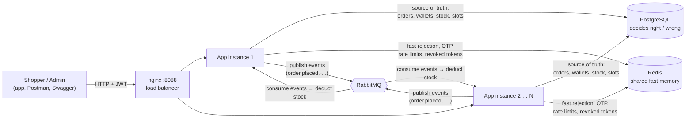
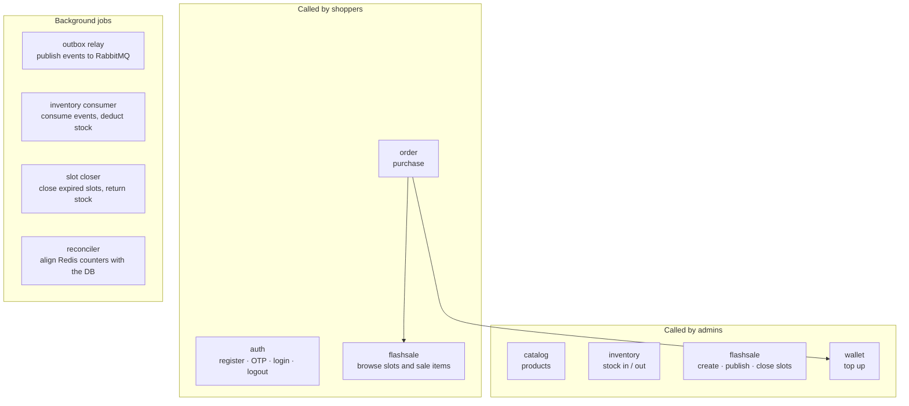
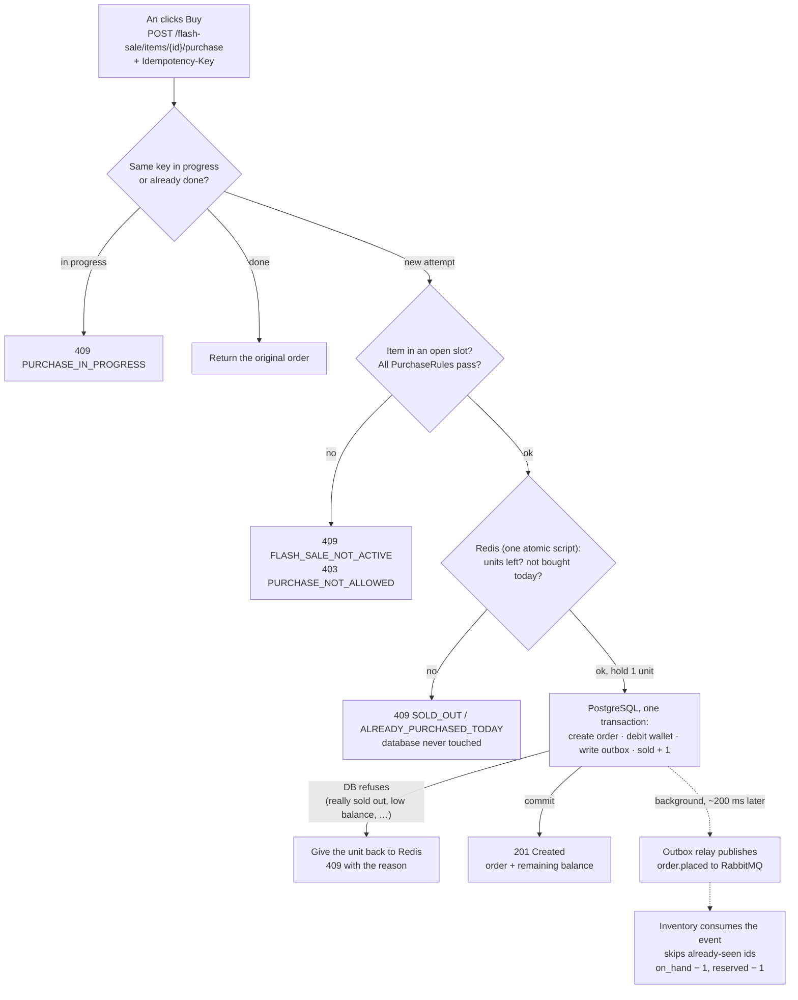
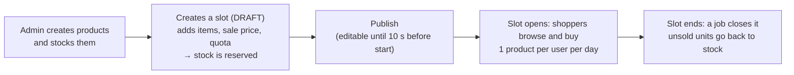

# FlashSale Service

Backend for a **flash sale** programme: discounted products, limited quantities, sold in fixed time slots during the day. It covers:

- **Accounts**: register, verify by OTP, log in and log out with an email address or a phone number.
- **Flash sale**: browse what is on sale, buy, and manage slots and their products (admin).
- **Inventory**: kept up to date automatically when someone buys or a product changes.

What the system must guarantee, even with thousands of simultaneous buyers and several instances running:

1. Never sell more than the configured quantity.
2. Each user buys at most **one flash sale product per day**.
3. Wallet balances and stock always match the orders.

Stack: Java 27, Spring Boot 4.1, PostgreSQL 18, Redis 8, RabbitMQ 4.4, nginx, Docker Compose.

---

## System overview

### Components and how they connect



All instances are identical and hold no state of their own, so scaling out is just running more of them (`--scale app=N`). Each instance does three jobs: serve the API, relay events from the `outbox` table to RabbitMQ, and consume events to update inventory.

### Inside one instance



### The path of one purchase



Redis is only a fast filter. If Redis miscounts or goes down entirely, PostgreSQL still prevents overselling (`sold < quota`) and a second purchase on the same day (unique `user_id, sale_date`). Details in [section 4](#4-how-correctness-is-guaranteed).

### A flash sale day



More detailed diagrams (data model, OTP, login, RabbitMQ, lifecycles): [docs/system-design.md](docs/system-design.md).

---

## 1. Running it

Only Docker is required:

```bash
docker compose up -d --wait
```

- The first run takes a few minutes to build the application.
- The command returns only when everything is ready. The app starts after Postgres, Redis and RabbitMQ are up and reports ready once it can reach the database, so the API is usable as soon as the command finishes. If Redis or RabbitMQ fail later, the app stays ready and keeps serving (see section 4).
- Schema and demo data are created automatically.

| What | Where |
|---|---|
| API | http://localhost:8088 |
| API docs (Swagger, try requests live) | http://localhost:8088/swagger-ui.html |
| RabbitMQ console | http://localhost:15672 (`flashsale` / `flashsale`) |

To run two app instances behind nginx:

```bash
docker compose up -d --wait --scale app=2
```

Every setting (ports, passwords, secrets) has a default for the demo environment. Copy `.env.example` to `.env` only if you need to change something.

---

## 2. Trying it with Postman

1. Import `postman/flashsale.postman_collection.json`.
2. Click **Run collection** to run everything, or run the requests folder by folder.

The collection handles the chores itself: it generates a fresh email for sign-up, reads the OTP, stores tokens after login and generates an `Idempotency-Key` for each purchase.

| Folder | Scenario |
|---|---|
| 0. Health & demo accounts | Health check, log in with the demo admin and user |
| 1. Auth — email | Register → get OTP → wrong OTP rejected → verify → log in → refresh → reuse the old refresh token (whole session revoked) → log out → old token rejected |
| 1b. Auth — phone & resend OTP | Register with a phone number, resend the OTP, log in with the number written differently (`+84…`, with spaces) |
| 2. Flash sale — shopper | Current sale and today's schedule → missing `Idempotency-Key` rejected → successful purchase → replay the same request (original order returned) → same key for another item (422) → second purchase of the day (409) |
| 3. Admin — products | Create, get, list, update products; duplicate SKU and invalid data rejected |
| 4. Admin — inventory | View stock, stock in, stock out, stock out beyond what is available rejected |
| 5. Admin — flash sale slots | Create a draft slot → reschedule → add / update / remove items (stock reserved and returned) → publish → close (unsold units returned) |
| 6. Admin — deactivate product | Deactivate a product → it cannot be added to new slots |
| 7. Admin — wallet top-up | Top up a wallet; replaying the same `Idempotency-Key` does not credit twice; bad amount or unknown user rejected |
| 8. Authorization & errors | No token (401), user calling an admin API (403), malformed id, broken JSON, unknown path |

### Demo data

| Account | Password | Notes |
|---|---|---|
| `admin@flashsale.local` | `Admin@12345` | Admin role |
| `user0001@flashsale.local` … `user1000@flashsale.local` | `User@12345` | Each wallet starts with 100,000,000 VND |

There are also 5 products and a flash sale slot **every 2 hours for 7 days** from start-up (Vietnam time), so a slot is always open when you try it. Each slot sells 3 products, one of them with only 5 units so the sold-out case is easy to see.

**About OTP:** the assignment allows OTP delivery to be simulated. Messages are written to the `notification_outbox` table instead of being emailed or texted, and `GET /api/v1/demo/otp?identifier=...` returns the latest code in place of opening an inbox. That endpoint and the demo data exist only in the demo profile.

---

## 3. API

Every error has the same shape: a stable error code for clients to act on (for example `SOLD_OUT`, `ALREADY_PURCHASED_TODAY`, `INSUFFICIENT_BALANCE`) and a `requestId` to find it in the logs.

### Accounts

One endpoint per action. The `identifier` field takes **an email address or a phone number** and the type is detected automatically. Different spellings of a phone number are the same account (`0901234567`, `090 123 4567` and `+84901234567` all match).

| Endpoint | Purpose |
|---|---|
| `POST /api/v1/auth/register` | Register and send an OTP |
| `POST /api/v1/auth/verify-otp` | Submit the OTP **and the password** to activate the account. The password sent here is the one that counts |
| `POST /api/v1/auth/resend-otp` | Resend the OTP (at most once every 60 seconds) |
| `POST /api/v1/auth/login` | Log in; returns an access token (valid 15 minutes) and a refresh token |
| `POST /api/v1/auth/refresh` | Exchange a refresh token for a new pair |
| `POST /api/v1/auth/logout` | Log out; tokens stop working immediately |
| `GET /api/v1/auth/me` | The logged-in account |

### Shopping

| Endpoint | Purpose |
|---|---|
| `GET /api/v1/flash-sale/current` | The open slot: items, sale prices, remaining quantities |
| `GET /api/v1/flash-sale/slots?date=2026-11-12` | The slots of a day |
| `POST /api/v1/flash-sale/items/{itemId}/purchase` | Buy an item. The `Idempotency-Key` header is required (see section 4) |
| `GET /api/v1/orders` | My flash sale orders |
| `GET /api/v1/wallet` | Wallet balance |

### Admin (admin accounts only)

| Endpoint | Purpose |
|---|---|
| `/api/v1/admin/products` | Create a product with its initial stock, update, deactivate |
| `/api/v1/admin/inventory/{productId}` | View stock, stock in or stock out |
| `/api/v1/admin/flash-sale/slots` | Create slots, add/update/remove their items, publish, close |
| `/api/v1/admin/wallets/{userId}/top-up` | Top up a wallet for testing. Optional `Idempotency-Key` header (UUID): replaying the same key for the same user and amount does not credit again; reusing it for another user or amount is rejected (422) |

Full request and response details are in Swagger.

---

## 4. How correctness is guaranteed

### What each component does

| Component | Role |
|---|---|
| **PostgreSQL** | Source of truth: accounts, wallets, products, stock, slots, orders. The important rules are database constraints, so bad data is refused even if the code has a bug |
| **Redis** | Fast memory shared by all instances: rejects purchases that are bound to fail, stores OTPs, counts rate limits, holds revoked tokens |
| **RabbitMQ** | Message broker: carries "order placed" events to the inventory module |
| **nginx** | Spreads requests across app instances |

Instances keep no state of their own apart from two one-second caches (see below), so handling more load means running more instances.

### When someone clicks "Buy"

Example: 3 iPhones left, An clicks Buy.

1. **Duplicate clicks are stopped.** If An clicks twice, the second request is told the first is still in progress. The two are recognised as one through the `Idempotency-Key` header: each purchase attempt carries its own key, and the same key means the same attempt.
2. **Slot check.** The item must belong to a slot that is open now.
3. **Fast check in Redis.** One Lua script runs atomically (no other request can interleave) and answers two questions: has An already bought today, and are there iPhones left? If not, the request is rejected right there without touching the database. This is what lets the system absorb a crowd clicking at once. It is not a lock: nobody waits, each request gets an immediate yes or no.
4. **One database transaction** (all or nothing):
   - create the order; the database refuses a second order for the same user on the same day;
   - debit the wallet, only if the balance is sufficient;
   - record an "order placed" event for inventory (see below);
   - increment the sold count, only while it is still below the quota.
5. **Afterwards:** on success, mark "An bought today". On failure, give the unit held in step 3 back to others.

### Why overselling cannot happen

Three layers:

| Layer | Stops | Purpose |
|---|---|---|
| Redis (step 3) | Sold out, already bought today | **Speed**: most failing requests never reach the database |
| "Increment sold only while stock remains" update | Overselling | **Correctness**: the database locks the item row while checking, so two buyers cannot both take the last unit |
| "One order per user per day" database constraint | Buying twice in a day | **Correctness**, even when Redis misbehaves |

If Redis miscounts or goes down completely, the two database layers still hold. The system gets slower, never wrong. One test deliberately corrupts the Redis counter to prove it.

The sold-count increment is the last statement of the transaction, so the most contended row, the item on sale, stays locked for as short a time as possible.

### In-memory caching

- **The "on sale now" page (`GET /flash-sale/current`)** is cached for one second per instance. When a sale opens, shoppers refresh constantly. Without the cache every refresh costs three queries and a database connection that purchases need. With it, each instance reads the database about once per second; when the entry expires only one request reloads it and the others wait for its result. Remaining quantities on screen can lag by up to one second. Whether a purchase succeeds is still decided by Redis and the database at purchase time, not by what the page showed.
- **Item data on the purchase path** (price, slot window) is also cached for one second, because it cannot change once the slot is open.
- **No warm-up before a slot opens**, on purpose. The caches are empty only for the first few milliseconds, until the first query returns. The Redis stock counter is seeded on the first purchase with a set-if-absent command, so concurrent seeding is harmless. A warm-up job would have to handle slots edited or cancelled at the last moment, several instances running the job, and restarts right at opening time, all to save those first few milliseconds.

### When things go wrong

| Situation | Behaviour |
|---|---|
| Redis down | The fast check is skipped and the database checks everything: still correct, just more database load. Redis commands fail immediately when the connection is lost, so nothing waits for a timeout. The revoked-token list cannot be read, so a logged-out token keeps working until it expires (15 minutes at most). Tested by stopping Redis for real: login, browsing, purchase (201) and a second purchase (409) all answered in about 5–20 ms, and the app recovered by itself when Redis came back |
| RabbitMQ down | Purchases work normally. Events wait in the `outbox` table (written in the same transaction as the order) and are sent once RabbitMQ is back, so stock updates are delayed, never lost |
| Server killed mid-purchase | The "bought today" flag lives only 60 seconds unless the order completes, so the buyer is not wrongly blocked. A job reconciles the Redis counters with the database every minute |
| Purchase replayed with the same `Idempotency-Key` | The original order is returned, nothing extra is bought |
| Old `Idempotency-Key` reused for a different item | Rejected (422) |
| Database overloaded | 503 with a hint to retry after one second, instead of a 500 |
| Admin closes a slot while people are buying | The quota is frozen at the number already sold; later buyers get "sold out" and stock stays consistent |

### How inventory is updated

Each product has two numbers:

- `on_hand`: units physically in stock;
- `reserved`: units set aside for flash sale slots but not yet sold.

When an admin puts 100 units into a slot, those 100 are reserved immediately. If there is not enough stock the admin is refused, so flash sales can never sell more than what is really in stock.

A purchase does not deduct stock directly. It writes an "order placed" event to the `outbox` table **in the same transaction as the order**, so there can never be an order without its event or an event without its order. A background job reads that table and publishes to RabbitMQ. The inventory module consumes the event and decrements `on_hand` and `reserved` by one.

Messages can be delivered more than once (a flaky network, for example). Every event has a unique id and inventory records the ids it has processed, so a repeated id is skipped. Each order deducts stock exactly once.

| When | Stock change |
|---|---|
| Admin adds a product to a slot | More units reserved (`reserved` goes up) |
| Someone buys | A unit leaves the warehouse (`on_hand` and `reserved` both drop by 1) |
| A slot ends (automatically) or an admin closes it early | Unsold units are released (`reserved` goes down) |
| Admin deactivates a product | It is removed from slots that have not started, and its reserved units are released |

If inventory fails to process an event, for example while the database restarts, it retries after 1, 3 and 9 seconds. If it still fails, the message goes to the `flashsale.dead-letters` queue, where it can be inspected and replayed from the RabbitMQ console. Malformed messages (no event id, invalid JSON) are not retried and go straight to `flashsale.dead-letters`.

If RabbitMQ refuses an event, it is retried after 1, 2, 4… seconds (capped at once every 5 minutes) instead of continuously, so it does not hold up other events. After 20 failed attempts an error is logged for an operator to look at.

### Security

- Passwords are hashed with Argon2id (19 MiB, 2 iterations, the OWASP baseline). Each instance runs at most one hash per CPU core at a time, so a burst of logins cannot exhaust memory. Older BCrypt hashes (the demo accounts) still log in and are rewritten as Argon2id on the first successful login. OTPs are never stored in plain form, expire after 5 minutes and are destroyed after 5 wrong attempts.
- **No account enumeration:** registration always gives the same answer, and a wrong password or an unknown email gets the same error in the same time.
- The password is set when the OTP is verified, not at registration. Someone who registers your email first still cannot take the account, because only whoever can read the OTP sets the password.
- Logging out revokes tokens immediately. A refresh token works once; if an old one is replayed (a sign of theft), the whole login session is revoked.
- Rate limits on registration, OTP, login and purchase.
- Database, Redis and RabbitMQ are not exposed outside the host; no secrets are hard-coded.

---

## 5. Testing

Run every test (needs JDK 27 and Docker; tests use real Postgres, Redis and RabbitMQ in containers):

```bash
./mvnw verify
```

What the tests prove:

- 1,000 users buying 100 units at once → exactly 100 orders, 900 "sold out", total debits match the orders.
- Redis counter deliberately wrong (claims 100,000 units left) → the database still sells exactly the quota.
- One user firing 50 requests at 5 different items at once → exactly 1 order.
- Replaying the same `Idempotency-Key` → the original order comes back, only 1 unit sold.
- An inventory event delivered 3 times → stock drops once.
- Deactivating a product → it leaves slots that have not started and its stock is returned.
- The whole account flow, anti-enumeration, logout, token refresh, Argon2id hashing and the BCrypt upgrade.
- Someone pre-registering another person's email cannot take the account (password set at OTP verification).
- Expired slots (drafts included) close automatically and return stock; one failing slot does not block the others.
- Failed event publishes back off, malformed messages go straight to the dead-letter queue; replaying a top-up does not credit twice.
- The `/current` cache reloads after one second, never shows an ended slot, and 200 concurrent misses hit the database once.
- A new purchase condition is just one more `PurchaseRule` class (there is a test showing it).
- Malformed parameters return 400, an overloaded database returns 503, no 500s leak out.

### Load testing (k6)

The assignment asks for at least 500 requests per second. To measure:

```bash
RATE_LIMIT_ENABLED=false docker compose up -d --wait --scale app=2
./load-test/run.sh                                                 # 600 requests/s for 60 s
BROWSE_RPS=1200 PURCHASE_RPS=800 DURATION=30s ./load-test/run.sh   # 2,000 requests/s for 30 s
```

- Traffic mixes browsing the current sale and clicking Buy, from 300 demo accounts.
- Rate limiting is off during the test, because each account may only buy 30 times per minute and that limit would throttle the test itself.
- Afterwards the script checks the data with `load-test/verify.sql`: no overselling, nobody with two orders in a day, every order debited exactly once, every inventory event delivered.

Results on an Apple M4 Max (Docker with 14 CPUs, 8 GB RAM), 2 app instances:

| Load | Duration | p95 latency | Server errors | Data inconsistencies |
|---|---|---|---|---|
| 600 requests/s | 60 s | 3.7 ms | 0 | 0 |
| 2,000 requests/s | 30 s | 1.9 ms | 0 | 0 |

In both runs k6 delivered 100% of the requested iterations at the target rate (36,000 and 60,000, none dropped).

The k6 report shows `http_req_failed` at around 40%. Those are "sold out" and "already bought today" answers (409). k6 counts every status of 400 or above as a failure by default, but in a flash sale they are the correct answers. The script counts only server errors (5xx) and timeouts as real failures.

---

## 6. Assumptions

- Days follow Vietnam time. A slot cannot span midnight, so every purchase belongs to exactly one day.
- "One flash sale product per user per day" applies across all slots and all products of that day.
- Published slots cannot overlap. A slot's items can be edited until 10 seconds before it starts (so the one-second price cache on the purchase path is never stale). A draft slot whose time has passed can no longer be edited and is closed by a job, which returns its reserved stock.
- Login is by email/phone and password; the OTP only confirms the email/phone at registration.
- Users already have money in their wallet (per the assignment); admins have a top-up API for testing.
- Orders are paid immediately from the wallet; there is no cancellation or refund yet.
- OTP delivery is simulated (written to the database and the log).

## 7. Possible extensions

- **Much higher traffic:** accept purchase requests into a queue and return the result asynchronously; split an item's quota across several counters so it is not a single hot spot.
- **Cancellation / refunds:** an "order cancelled" event that returns stock and refunds the wallet.
- **Real OTP delivery:** a worker that reads `notification_outbox` and calls an email/SMS provider.
- **Revenue and sell-through reporting:** stream events into a separate analytics store (ClickHouse, for example) instead of loading the main database.
- **More purchase conditions** (membership tier, region, …): write a class implementing `PurchaseRule` (`order/application/PurchaseRule.java`). Every rule runs after the item is confirmed on sale and before a unit is held, so the purchase flow does not change. Rule settings (a minimum tier, say) live in the database like the rest of the flash sale configuration.
- **Kafka instead of RabbitMQ** if event history must be replayable or volumes get very large: only the publishing and consuming adapters change, the business logic stays the same.

## 8. Code layout

```
src/main/java/com/flashsale/
  auth/        registration, OTP, login, tokens
  wallet/      wallets and their transactions
  catalog/     products
  inventory/   stock, consumes "order placed" events
  flashsale/   slots, sale items, the Redis fast check, closing expired slots
  order/       purchase flow
  outbox/      writing and publishing events to RabbitMQ
  shared/      cross-cutting: error format, security, time zone, rate limiting
src/main/resources/db/migration   database schema
src/main/resources/db/demo        demo data
postman/       Postman collection
load-test/     load test scripts and post-test data checks
docs/          system design and diagrams
```

Each module has four layers:
- `api`: handles requests;
- `application`: business logic;
- `domain`: concepts and rules;
- `infrastructure`: database, Redis, RabbitMQ.

Modules call each other only through their `application` layer. An automated test (`ArchitectureTest`) enforces this: breaking the rule fails the build.
