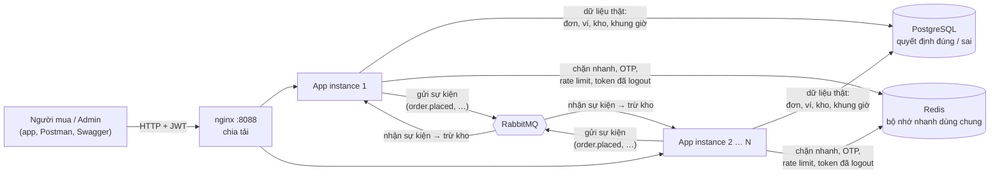
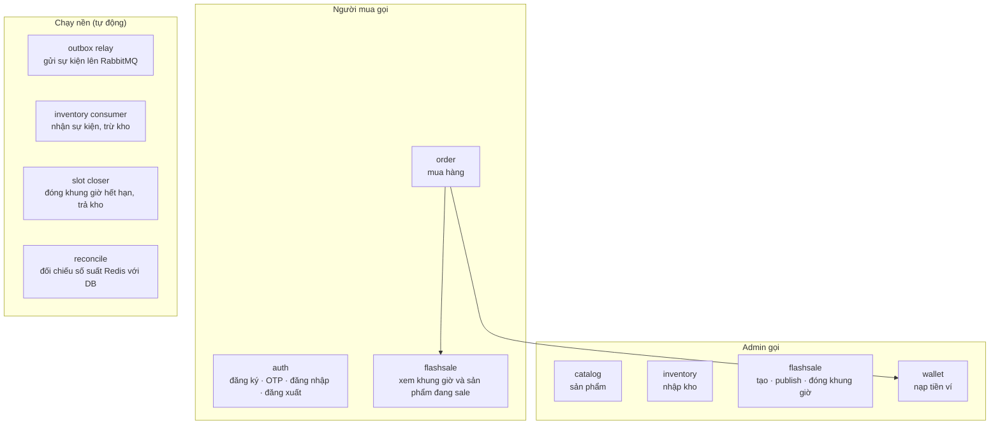
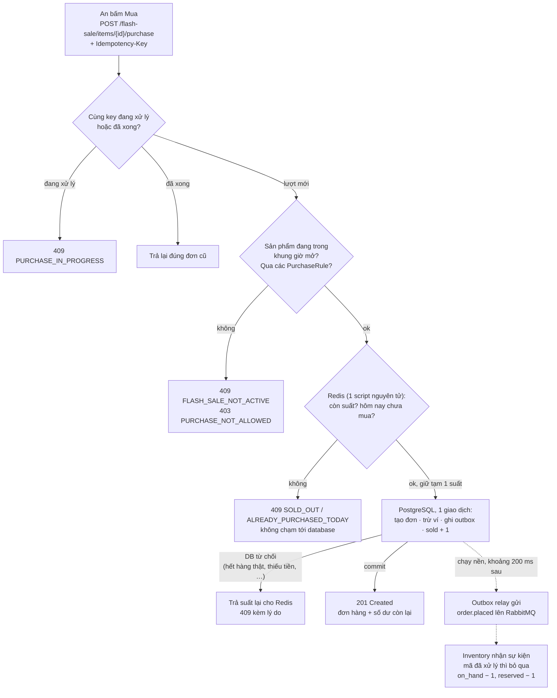
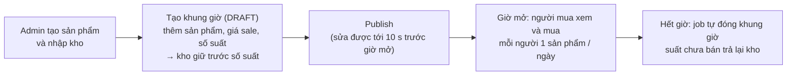

# FlashSale Service

Backend cho một chương trình **flash sale**: bán sản phẩm giá rẻ, số lượng có hạn, trong những khung giờ cố định trong ngày. Hệ thống gồm:

- **Tài khoản**: đăng ký, xác thực OTP, đăng nhập, đăng xuất bằng email hoặc số điện thoại.
- **Flash sale**: xem sản phẩm đang sale, mua hàng, quản lý khung giờ và sản phẩm (admin).
- **Tồn kho**: tự cập nhật khi có người mua hoặc khi sản phẩm thay đổi.

Điều quan trọng nhất hệ thống phải đảm bảo, kể cả khi hàng nghìn người bấm mua cùng lúc và khi chạy nhiều instance:

1. Không bán quá số lượng đã cấu hình.
2. Mỗi người chỉ mua được **1 sản phẩm flash sale mỗi ngày**.
3. Tiền trong ví và tồn kho luôn khớp với số đơn hàng.

Công nghệ: Java 27, Spring Boot 4.1, PostgreSQL 18, Redis 8, RabbitMQ 4.4, nginx, Docker Compose.

---

## Toàn cảnh hệ thống

### Các khối và cách chúng nối với nhau



Mọi instance giống hệt nhau và không giữ dữ liệu riêng, nên muốn chịu tải hơn chỉ cần chạy thêm instance (`--scale app=N`). Mỗi instance làm cả ba việc: phục vụ API, gửi sự kiện từ bảng `outbox` lên RabbitMQ, và nhận sự kiện để cập nhật tồn kho.

### Bên trong một instance



### Một lượt mua đi qua những đâu



Redis chỉ để lọc nhanh. Nếu Redis đếm sai hoặc ngừng hẳn, PostgreSQL vẫn chặn bán quá (`sold < quota`) và chặn mua 2 lần trong ngày (unique `user_id, sale_date`). Chi tiết ở [phần 4](#4-hệ-thống-đảm-bảo-đúng-như-thế-nào).

### Một ngày flash sale



Sơ đồ chi tiết hơn (bảng dữ liệu, luồng OTP, đăng nhập, RabbitMQ, vòng đời): [docs/system-design.md](docs/system-design.md).

---

## 1. Chạy hệ thống

Máy chỉ cần cài Docker. Chạy một lệnh:

```bash
docker compose up -d --wait
```

- Lần đầu sẽ mất vài phút để build ứng dụng.
- Lệnh chỉ kết thúc khi mọi thành phần đã sẵn sàng. Ứng dụng chỉ khởi động sau khi Postgres, Redis và RabbitMQ đã chạy, và chỉ báo "sẵn sàng" khi đã kết nối được database, nên khi lệnh chạy xong là gọi API được ngay. Redis hay RabbitMQ gặp sự cố sau đó thì ứng dụng vẫn báo sẵn sàng và vẫn phục vụ (xem mục 4).
- Bảng dữ liệu và dữ liệu mẫu được tạo tự động, không cần làm gì thêm.

| Mở ở đâu | Địa chỉ |
|---|---|
| API | http://localhost:8088 |
| Tài liệu API (Swagger, bấm thử trực tiếp) | http://localhost:8088/swagger-ui.html |
| Giao diện RabbitMQ | http://localhost:15672 (tài khoản `flashsale` / `flashsale`) |

Muốn chạy 2 bản ứng dụng song song (nginx tự chia request cho cả hai):

```bash
docker compose up -d --wait --scale app=2
```

Mọi cấu hình (cổng, mật khẩu, khoá bí mật) đã có sẵn giá trị cho môi trường demo. Chỉ khi cần đổi mới copy `.env.example` thành `.env` rồi sửa.

---

## 2. Thử bằng Postman

1. Import file `postman/flashsale.postman_collection.json` vào Postman.
2. Bấm **Run collection** để chạy hết, hoặc chạy lần lượt từng request trong từng thư mục.

Collection tự lo các bước lặt vặt: tự tạo email mới khi đăng ký, tự đọc mã OTP, tự lưu token sau khi đăng nhập, tự sinh `Idempotency-Key` khi mua.

| Thư mục | Kịch bản |
|---|---|
| 0. Health & demo accounts | Kiểm tra hệ thống, đăng nhập bằng tài khoản admin và user có sẵn |
| 1. Auth — email | Đăng ký → lấy OTP → OTP sai bị từ chối → xác thực → đăng nhập → làm mới token → dùng lại refresh token cũ (cả phiên bị huỷ) → đăng xuất → token cũ bị từ chối |
| 1b. Auth — phone & resend OTP | Đăng ký bằng số điện thoại, gửi lại OTP, đăng nhập bằng số viết kiểu khác (`+84…`, có dấu cách) |
| 2. Flash sale — shopper | Xem sản phẩm đang sale, lịch trong ngày → thiếu `Idempotency-Key` bị từ chối → mua thành công → gửi lại đúng request đó (nhận lại đơn cũ) → dùng key đó cho sản phẩm khác (422) → mua sản phẩm thứ hai trong ngày (409) |
| 3. Admin — products | Tạo, xem, liệt kê, sửa sản phẩm; SKU trùng và dữ liệu sai bị từ chối |
| 4. Admin — inventory | Xem tồn kho, nhập thêm, xuất bớt, xuất quá số lượng bị từ chối |
| 5. Admin — flash sale slots | Tạo khung giờ nháp → đổi giờ → thêm / sửa / xoá sản phẩm (kho tự giữ và trả hàng) → publish → đóng (hàng chưa bán trả về kho) |
| 6. Admin — deactivate product | Ngừng bán sản phẩm → không thể đưa vào khung giờ mới |
| 7. Admin — wallet top-up | Nạp tiền vào ví; gửi lại cùng `Idempotency-Key` không cộng tiền 2 lần; số tiền sai hoặc user không tồn tại bị từ chối |
| 8. Authorization & errors | Không token (401), user thường gọi API admin (403), id sai định dạng, JSON hỏng, đường dẫn không tồn tại |

### Dữ liệu có sẵn

| Tài khoản | Mật khẩu | Ghi chú |
|---|---|---|
| `admin@flashsale.local` | `Admin@12345` | Quyền admin |
| `user0001@flashsale.local` … `user1000@flashsale.local` | `User@12345` | Mỗi ví có sẵn 100.000.000đ |

Ngoài ra có 5 sản phẩm và lịch flash sale **mỗi 2 tiếng, kéo dài 7 ngày** kể từ lúc khởi động (giờ Việt Nam), nên lúc nào thử cũng có một khung giờ đang mở. Mỗi khung giờ bán 3 sản phẩm, trong đó có 1 sản phẩm chỉ 5 suất để dễ thấy trường hợp hết hàng.

**Về OTP:** đề bài cho phép giả lập việc gửi OTP. Hệ thống ghi tin nhắn vào bảng `notification_outbox` thay vì gửi email/SMS thật, và có thêm API `GET /api/v1/demo/otp?identifier=...` để đọc mã vừa gửi, thay cho việc mở hộp thư. API này và dữ liệu mẫu chỉ tồn tại ở chế độ demo, không dùng cho môi trường thật.

---

## 3. Danh sách API

Khi có lỗi, mọi API trả về cùng một dạng, gồm một mã lỗi cố định để client xử lý (ví dụ `SOLD_OUT`, `ALREADY_PURCHASED_TODAY`, `INSUFFICIENT_BALANCE`) và một `requestId` để tra log.

### Tài khoản

Mỗi chức năng chỉ có một API. Trường `identifier` nhận **email hoặc số điện thoại**; hệ thống tự nhận biết loại nào. Số điện thoại viết kiểu nào cũng được coi là một (`0901234567`, `090 123 4567` hay `+84901234567` đều là cùng một tài khoản).

| API | Chức năng |
|---|---|
| `POST /api/v1/auth/register` | Đăng ký và gửi OTP |
| `POST /api/v1/auth/verify-otp` | Nhập OTP **và mật khẩu** để kích hoạt tài khoản. Mật khẩu có hiệu lực là mật khẩu gửi ở bước này |
| `POST /api/v1/auth/resend-otp` | Gửi lại OTP (tối thiểu cách nhau 60 giây) |
| `POST /api/v1/auth/login` | Đăng nhập, nhận access token (hiệu lực 15 phút) và refresh token |
| `POST /api/v1/auth/refresh` | Đổi refresh token lấy cặp token mới |
| `POST /api/v1/auth/logout` | Đăng xuất, token hết hiệu lực ngay lập tức |
| `GET /api/v1/auth/me` | Thông tin tài khoản đang đăng nhập |

### Mua hàng

| API | Chức năng |
|---|---|
| `GET /api/v1/flash-sale/current` | Khung giờ đang mở: danh sách sản phẩm, giá sale, số lượng còn lại |
| `GET /api/v1/flash-sale/slots?date=2026-11-12` | Lịch các khung giờ trong một ngày |
| `POST /api/v1/flash-sale/items/{itemId}/purchase` | Mua sản phẩm. Bắt buộc gửi header `Idempotency-Key` (giải thích ở mục 4) |
| `GET /api/v1/orders` | Các đơn flash sale của tôi |
| `GET /api/v1/wallet` | Số dư ví |

### Quản trị (chỉ tài khoản admin)

| API | Chức năng |
|---|---|
| `/api/v1/admin/products` | Tạo sản phẩm kèm số lượng tồn kho ban đầu, sửa, ngừng bán |
| `/api/v1/admin/inventory/{productId}` | Xem tồn kho, nhập thêm hoặc xuất bớt hàng |
| `/api/v1/admin/flash-sale/slots` | Tạo khung giờ, thêm/sửa/xoá sản phẩm trong khung giờ, publish, đóng |
| `/api/v1/admin/wallets/{userId}/top-up` | Nạp tiền vào ví để test. Header `Idempotency-Key` (UUID, không bắt buộc): gửi lại cùng key, cùng user, cùng số tiền thì không cộng thêm; dùng key đó cho user hoặc số tiền khác thì bị từ chối (422) |

Chi tiết từng request/response xem trên Swagger.

---

## 4. Hệ thống đảm bảo đúng như thế nào

### Mỗi thành phần làm gì

| Thành phần | Vai trò |
|---|---|
| **PostgreSQL** | Nơi lưu dữ liệu thật: tài khoản, ví, sản phẩm, tồn kho, khung giờ, đơn hàng. Các quy tắc quan trọng được khai báo thành ràng buộc trong DB, nên kể cả code có lỗi thì DB vẫn từ chối dữ liệu sai |
| **Redis** | Bộ nhớ nhanh dùng chung cho mọi instance: chặn sớm request mua chắc chắn thất bại, lưu OTP, đếm rate limit, lưu danh sách token đã đăng xuất |
| **RabbitMQ** | Hàng đợi tin nhắn: chuyển thông báo "vừa có đơn hàng" sang phần tồn kho để trừ kho |
| **nginx** | Chia request cho các instance ứng dụng |

Ứng dụng không giữ dữ liệu nào trong bộ nhớ riêng của từng instance (trừ một bộ nhớ đệm 1 giây cho thông tin sản phẩm đang sale). Vì vậy muốn chịu tải nhiều hơn chỉ cần chạy thêm instance.

### Khi một người bấm "Mua"

Ví dụ: còn 3 suất iPhone, An bấm mua.

1. **Chặn bấm trùng.** An bấm 2 lần liên tiếp thì lần thứ hai bị báo "đang xử lý". Hai lần bấm được nhận ra là một nhờ header `Idempotency-Key`: mỗi lượt mua gửi kèm một mã riêng, gửi lại cùng mã nghĩa là cùng một lượt.
2. **Kiểm tra khung giờ.** Sản phẩm phải thuộc khung giờ đang mở.
3. **Kiểm tra nhanh trên Redis.** Một đoạn script chạy liền một mạch, không request nào chen vào giữa được, để trả lời 2 câu: An hôm nay đã mua chưa, và iPhone còn suất không. Nếu không được mua thì từ chối ngay, không chạm tới database. Đây là bước giúp hệ thống chịu được nhiều người bấm cùng lúc.
4. **Ghi vào database trong một giao dịch duy nhất** (thành công tất cả hoặc không có gì):
   - tạo đơn hàng; database không cho cùng một người có 2 đơn trong cùng một ngày;
   - trừ tiền ví, chỉ khi số dư đủ;
   - ghi lại sự kiện "có đơn mới" để cập nhật tồn kho (xem phần dưới);
   - tăng số đã bán, chỉ khi số đã bán vẫn còn nhỏ hơn số lượng cho phép.
5. **Sau khi xong:** thành công thì đánh dấu "An đã mua hôm nay". Thất bại thì trả lại suất vừa giữ ở bước 3 cho người khác.

### Vì sao chắc chắn không bán quá

Có ba lớp chặn:

| Lớp | Chặn cái gì | Mục đích |
|---|---|---|
| Redis (bước 3) | Hết hàng, đã mua hôm nay | Để **nhanh**: phần lớn request thất bại không cần tới database |
| Câu cập nhật "chỉ tăng số đã bán khi còn hàng" | Bán quá số lượng | Để **đúng**: database khoá dòng sản phẩm khi kiểm tra, hai người không thể cùng lấy suất cuối |
| Ràng buộc "mỗi người 1 đơn mỗi ngày" trong database | Mua 2 lần trong ngày | Để **đúng**, kể cả khi Redis gặp sự cố |

Nếu Redis đếm sai, hoặc ngừng hoạt động hẳn, hai lớp trong database vẫn giữ đúng. Hệ thống chỉ chậm hơn chứ không bán sai. Có một test cố tình làm Redis đếm sai để chứng minh điều này.

Bước "tăng số đã bán" được đặt cuối cùng trong giao dịch. Như vậy dòng dữ liệu của sản phẩm đang sale, chỗ bị tranh chấp nhiều nhất, chỉ bị khoá trong thời gian rất ngắn.

### Những tình huống không suôn sẻ

| Tình huống | Hệ thống xử lý |
|---|---|
| Redis không hoạt động | Bỏ qua bước kiểm tra nhanh, database tự kiểm tra hết: vẫn đúng, chỉ tốn thêm tải cho database. Lệnh gửi tới Redis bị từ chối ngay khi mất kết nối nên không phải chờ timeout. Riêng danh sách token đã đăng xuất không đọc được, nên token đã đăng xuất vẫn dùng được tới khi hết hạn (tối đa 15 phút). Đã thử tắt Redis thật: đăng nhập, xem sale, mua (201), mua lần hai (409) đều phản hồi trong khoảng 5–20 ms; bật lại Redis thì tự phục hồi |
| RabbitMQ không hoạt động | Mua hàng vẫn bình thường. Sự kiện nằm chờ trong bảng `outbox` (cùng giao dịch với đơn) và được gửi khi RabbitMQ chạy lại, nên tồn kho chỉ cập nhật trễ chứ không mất |
| Server tắt đột ngột giữa lúc đang mua | Dấu "đã mua hôm nay" chỉ giữ 60 giây nếu đơn chưa hoàn tất, nên người mua không bị chặn oan. Một job chạy mỗi phút đối chiếu lại số suất trong Redis với database |
| Gửi lại request mua với cùng `Idempotency-Key` | Trả lại đúng đơn đã tạo, không mua thêm |
| Dùng lại `Idempotency-Key` cũ để mua sản phẩm khác | Từ chối (lỗi 422) |
| Database quá tải | Trả lỗi 503 kèm gợi ý thử lại sau 1 giây, thay vì lỗi 500 |
| Admin đóng khung giờ đúng lúc có người đang mua | Lúc đóng, số lượng được chốt bằng đúng số đã bán; người mua sau đó nhận "hết hàng", tồn kho không bị lệch |

### Tồn kho được cập nhật như thế nào

Mỗi sản phẩm có 2 con số:

- `on_hand`: số hàng thực có trong kho;
- `reserved`: số hàng đã giữ cho các khung giờ flash sale nhưng chưa bán.

Khi admin đưa 100 cái vào một khung giờ, kho giữ 100 cái đó ngay lập tức. Nếu kho không đủ hàng thì admin bị từ chối, nên tổng số bán flash sale không bao giờ vượt hàng thật trong kho.

Khi có người mua, đơn hàng không trừ kho ngay mà ghi lại một sự kiện "có đơn mới" vào bảng `outbox`, **trong cùng giao dịch với đơn hàng**. Nhờ vậy không thể xảy ra chuyện có đơn mà mất sự kiện, hay có sự kiện mà không có đơn. Một job chạy nền đọc bảng này rồi gửi lên RabbitMQ. Phần tồn kho nhận sự kiện và trừ `on_hand` và `reserved` đi 1.

Tin nhắn có thể bị gửi trùng (ví dụ mạng chập chờn). Mỗi sự kiện có một mã riêng, phần tồn kho ghi lại các mã đã xử lý, nên gặp lại mã cũ thì bỏ qua. Kết quả là mỗi đơn chỉ trừ kho đúng 1 lần.

| Khi nào | Tồn kho thay đổi |
|---|---|
| Admin đưa sản phẩm vào khung giờ | Giữ thêm hàng (`reserved` tăng) |
| Có người mua | Hàng rời kho (`on_hand` và `reserved` cùng giảm 1) |
| Khung giờ kết thúc (tự động) hoặc admin đóng sớm | Hàng chưa bán được trả lại (`reserved` giảm) |
| Admin ngừng bán sản phẩm | Sản phẩm tự rời các khung giờ chưa diễn ra, hàng giữ chỗ được trả lại |

Nếu phần tồn kho gặp lỗi khi xử lý, ví dụ database đang khởi động lại, hệ thống tự thử lại sau 1, 3 rồi 9 giây. Vẫn lỗi thì tin nhắn được chuyển sang hàng đợi `flashsale.dead-letters` để xem và xử lý lại bằng giao diện RabbitMQ. Tin nhắn hỏng (thiếu mã sự kiện, JSON sai) không thử lại mà chuyển thẳng sang `flashsale.dead-letters`.

Nếu RabbitMQ từ chối một sự kiện, sự kiện đó được gửi lại sau 1, 2, 4… giây (tối đa 5 phút một lần) thay vì liên tục, nên không chặn các sự kiện khác. Gửi lỗi quá 20 lần thì ghi log lỗi để người vận hành kiểm tra.

### Bảo mật

- Mật khẩu được băm một chiều bằng Argon2id (19 MiB, 2 vòng, theo khuyến nghị OWASP). Mỗi instance chỉ băm tối đa số lõi CPU cùng lúc để đợt đăng nhập dồn dập không làm tràn bộ nhớ. Hash BCrypt cũ (tài khoản demo) vẫn đăng nhập được và tự đổi sang Argon2id ở lần đăng nhập đúng đầu tiên. OTP không lưu dạng gốc, hết hạn sau 5 phút, nhập sai 5 lần thì bị huỷ.
- **Không để lộ ai đã có tài khoản:** đăng ký luôn trả cùng một câu trả lời; đăng nhập sai mật khẩu hay email không tồn tại đều nhận cùng một lỗi, với thời gian phản hồi như nhau.
- Mật khẩu được đặt lúc nhập OTP, không phải lúc đăng ký. Người khác đăng ký trước bằng email của bạn cũng không chiếm được tài khoản, vì chỉ người đọc được OTP mới đặt được mật khẩu.
- Đăng xuất làm token hết hiệu lực ngay lập tức. Refresh token chỉ dùng được một lần; nếu token cũ bị dùng lại (dấu hiệu bị đánh cắp), toàn bộ phiên đăng nhập đó bị huỷ.
- Giới hạn số lần gọi (rate limit) cho đăng ký, OTP, đăng nhập và mua hàng.
- Database, Redis, RabbitMQ không mở ra ngoài máy; khoá bí mật không ghi cứng trong code.

---

## 5. Kiểm thử

Chạy toàn bộ test (cần JDK 27 và Docker; test dùng Postgres, Redis, RabbitMQ thật chạy trong Docker):

```bash
./mvnw verify
```

Những gì test chứng minh:

- 1.000 người cùng mua 100 suất → đúng 100 đơn, 900 người nhận "hết hàng", tổng tiền bị trừ khớp với số đơn.
- Cố tình làm Redis đếm sai (tin là còn 100.000 suất) → database vẫn chỉ bán đúng số lượng.
- Một người gửi 50 request vào 5 sản phẩm khác nhau cùng lúc → chỉ có 1 đơn.
- Gửi lại cùng `Idempotency-Key` → nhận lại đúng đơn cũ, chỉ bán 1.
- Một sự kiện tồn kho bị gửi 3 lần → kho chỉ giảm 1 lần.
- Ngừng bán sản phẩm → sản phẩm tự rời các khung giờ chưa diễn ra, hàng trả về kho.
- Toàn bộ luồng tài khoản, chống dò tài khoản, đăng xuất, làm mới token.
- Kẻ xấu đăng ký trước bằng email của người khác cũng không chiếm được tài khoản (mật khẩu đặt lúc nhập OTP).
- Khung giờ hết hạn (kể cả bản nháp) tự đóng và trả hàng về kho, một khung giờ lỗi không chặn các khung giờ khác.
- Sự kiện gửi lỗi được thử lại thưa dần, tin nhắn hỏng vào thẳng hàng đợi lỗi; nạp tiền gửi lại cùng key không cộng 2 lần.
- Thêm một điều kiện mua mới chỉ cần thêm một class `PurchaseRule` (có test minh hoạ).
- Tham số sai định dạng trả 400, database quá tải trả 503, không lộ lỗi 500.

### Đo tải (k6)

Đề yêu cầu tối thiểu 500 request/giây. Cách đo:

```bash
RATE_LIMIT_ENABLED=false docker compose up -d --wait --scale app=2
./load-test/run.sh                                                 # 600 request/giây trong 60 giây
BROWSE_RPS=1200 PURCHASE_RPS=800 DURATION=30s ./load-test/run.sh   # 2.000 request/giây trong 30 giây
```

- Lưu lượng gồm cả xem sản phẩm đang sale và bấm mua, từ 300 tài khoản demo.
- Rate limit được tắt khi đo, vì mỗi tài khoản chỉ được mua 30 lần/phút và giới hạn này sẽ chặn bớt request của bài đo.
- Đo xong, script tự kiểm tra lại dữ liệu bằng `load-test/verify.sql`: không bán quá, không ai có 2 đơn trong ngày, mỗi đơn trừ tiền đúng 1 lần, sự kiện tồn kho đã gửi hết.

Kết quả trên Apple M4 Max (Docker 14 CPU, 8 GB RAM), 2 instance ứng dụng:

| Tải | Thời gian | 95% request phản hồi trong | Lỗi server | Sai lệch dữ liệu |
|---|---|---|---|---|
| 600 request/giây | 60 giây | 3,7 ms | 0 | 0 |
| 2.000 request/giây | 30 giây | 1,9 ms | 0 | 0 |

Cả hai lần đo, k6 chạy đủ 100% lượt theo tốc độ yêu cầu (36.000 và 60.000 lượt, không lượt nào bị bỏ).

Báo cáo k6 có dòng `http_req_failed` khoảng 40%. Đó là các phản hồi "hết hàng" hoặc "đã mua hôm nay" (mã 409). k6 mặc định coi mọi mã từ 400 trở lên là lỗi, nhưng trong flash sale đây là câu trả lời đúng. Script chỉ tính lỗi server (5xx) và timeout là lỗi thật.

---

## 6. Các giả định

- Ngày được tính theo giờ Việt Nam. Một khung giờ không được kéo qua nửa đêm, nên mỗi lượt mua thuộc về đúng một ngày.
- "Mỗi người 1 sản phẩm flash sale mỗi ngày" áp dụng chung cho tất cả khung giờ và tất cả sản phẩm trong ngày.
- Các khung giờ đã publish không được trùng thời gian nhau. Sản phẩm trong một khung giờ chỉ sửa được tới 10 giây trước khi khung giờ bắt đầu (để giá đang được cache 1 giây ở luồng mua không bị cũ). Khung giờ nháp đã hết giờ không sửa được nữa và được job tự đóng, trả hàng giữ chỗ về kho.
- Đăng nhập bằng email/số điện thoại và mật khẩu; OTP dùng để xác nhận email/số điện thoại khi đăng ký.
- Người dùng đã có sẵn tiền trong ví (theo đề bài); admin có API nạp tiền để test.
- Đơn hàng được thanh toán ngay bằng tiền trong ví; chưa có chức năng huỷ hoặc hoàn đơn.
- Gửi OTP là giả lập (ghi vào database và log).

## 7. Hướng mở rộng

- **Lượng truy cập lớn hơn nhiều:** nhận yêu cầu mua vào hàng đợi rồi trả kết quả sau; chia số suất của một sản phẩm ra nhiều nơi để không dồn vào một điểm.
- **Huỷ / hoàn đơn:** thêm sự kiện "huỷ đơn" để trả hàng về kho và hoàn tiền vào ví.
- **Gửi OTP thật:** thêm một tiến trình đọc bảng `notification_outbox` và gọi dịch vụ email/SMS.
- **Báo cáo doanh thu, tốc độ bán hết:** đẩy sự kiện sang một kho dữ liệu riêng cho thống kê (ví dụ ClickHouse), không làm nặng database chính.
- **Thêm điều kiện mua** (theo hạng thành viên, theo khu vực…): viết một class implement `PurchaseRule` (`order/application/PurchaseRule.java`). Mọi rule được kiểm tra sau khi xác nhận sản phẩm đang sale và trước khi giữ suất, nên không cần sửa luồng mua. Cấu hình của rule (ví dụ hạng tối thiểu) để trong database như phần còn lại của flash sale.
- **Đổi RabbitMQ sang Kafka** nếu cần đọc lại lịch sử sự kiện hoặc lượng sự kiện rất lớn: chỉ phải viết lại phần gửi/nhận tin, logic nghiệp vụ giữ nguyên.

## 8. Cấu trúc mã nguồn

```
src/main/java/com/flashsale/
  auth/        đăng ký, OTP, đăng nhập, token
  wallet/      ví và lịch sử giao dịch
  catalog/     sản phẩm
  inventory/   tồn kho, nhận sự kiện "có đơn mới"
  flashsale/   khung giờ, sản phẩm sale, kiểm tra nhanh trên Redis, tự đóng khung giờ hết hạn
  order/       luồng mua hàng
  outbox/      ghi và gửi sự kiện lên RabbitMQ
  shared/      phần dùng chung: định dạng lỗi, bảo mật, múi giờ, rate limit
src/main/resources/db/migration   cấu trúc database
src/main/resources/db/demo        dữ liệu mẫu
postman/       bộ request Postman
load-test/     kịch bản đo tải và kiểm tra dữ liệu sau khi đo
docs/          thiết kế hệ thống và sơ đồ
```

Mỗi module chia thành 4 lớp:
- `api`: nhận request;
- `application`: xử lý nghiệp vụ;
- `domain`: khái niệm và quy tắc;
- `infrastructure`: làm việc với database, Redis, RabbitMQ.

Các module chỉ gọi nhau qua lớp `application`. Quy tắc này được kiểm tra tự động bằng test (`ArchitectureTest`): viết sai là build lỗi.
