# FlashSale Service — System Design

Tài liệu mô tả kiến trúc, dữ liệu và **đường đi của từng luồng** trong hệ thống. Sơ đồ viết bằng Mermaid (GitHub tự hiển thị).

Stack: Java 27 · Spring Boot 4.1 · PostgreSQL 18 · Redis 8 · RabbitMQ 4.4 · nginx · Docker Compose. ClickHouse là hướng mở rộng (không thuộc phạm vi bản nộp).

---

## 1. Tổng quan kiến trúc

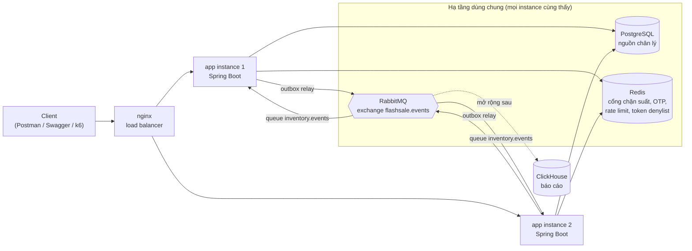

**Ý chính**
- App **không giữ state cục bộ**: mọi thứ cần chia sẻ (OTP, cờ đã mua, số suất, rate limit, token đã logout) nằm ở Redis/Postgres ⇒ thêm instance chỉ là `--scale app=N`.
- **Postgres** quyết định đúng/sai (ràng buộc cứng). **Redis** lọc tải trước khi chạm Postgres. **RabbitMQ** chuyển sự kiện để cập nhật tồn kho bất đồng bộ.
- Mỗi app instance vừa phục vụ API, vừa chạy relay outbox, vừa là consumer — không cần service riêng.

---

## 2. Module bên trong app

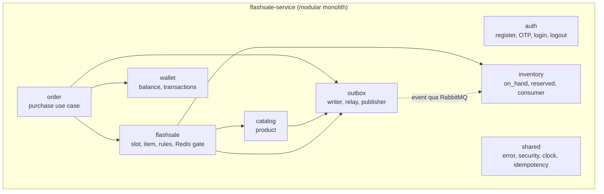

Mỗi module chia 4 lớp, phụ thuộc một chiều (ArchUnit kiểm):

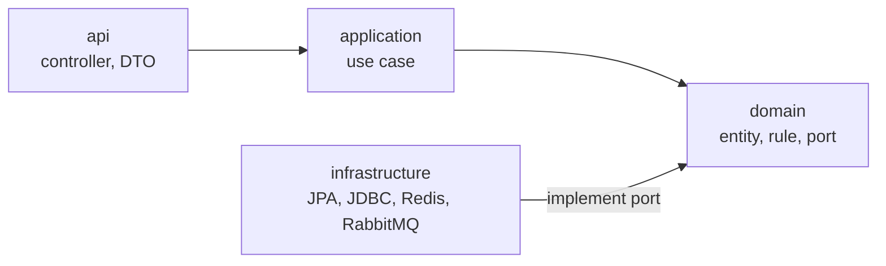

---

## 3. Dữ liệu (PostgreSQL)

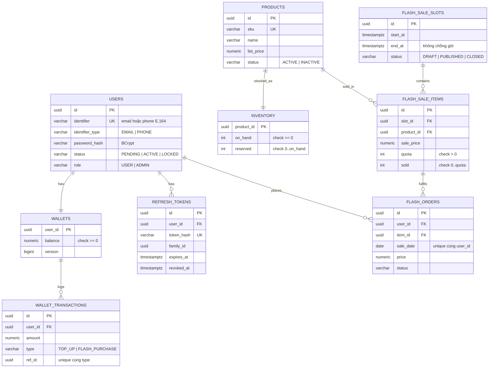

Bảng hạ tầng: `outbox` (sự kiện chờ gửi), `processed_events` (sự kiện đã xử lý, chống trùng), `notification_outbox` (mock gửi OTP).

**Ràng buộc cứng — tuyến phòng thủ cuối cùng**

| Ràng buộc | Chặn lỗi gì |
|---|---|
| `flash_sale_items.sold <= quota` (check) + `UPDATE ... WHERE sold < quota` | Bán quá số lượng |
| `unique (flash_orders.user_id, sale_date)` | User mua 2 sản phẩm flash sale trong 1 ngày |
| `wallets.balance >= 0` + `UPDATE ... WHERE balance >= price` | Trừ tiền âm |
| Exclusion constraint trên `tstzrange(start_at, end_at)` | Hai khung giờ chồng nhau |
| `inventory.reserved <= on_hand` | Cấp quota vượt tồn kho thật |
| `processed_events (consumer, event_id)` PK | Xử lý trùng sự kiện tồn kho |

---

## 4. Redis — key nào, để làm gì

| Key | Giá trị | TTL | Dùng cho |
|---|---|---|---|
| `fs:stock:{itemId}` | số suất còn lại | đến hết slot | Cổng chặn: hết suất thì từ chối ngay |
| `fs:bought:{yyyyMMdd}:{userId}` | itemId đã mua | hết ngày + 1h | Cổng chặn: hôm nay mua rồi |
| `otp:{type}:{identifier}` | hash OTP + số lần sai | 5 phút | Xác thực OTP |
| `otp:cooldown:{identifier}` | 1 | 60 giây | Chặn gửi lại OTP liên tục |
| `jwt:deny:{jti}` | 1 | thời gian còn lại của token | Token đã logout |
| `idem:{userId}:{key}` | kết quả request | 24h | Chống bấm mua 2 lần |
| `rl:{scope}:{ip/identifier}` | bucket | theo cửa sổ | Rate limit |
| `fs:current` | JSON danh sách đang sale | 2 giây | Cache API xem danh sách |

---

## 5. Luồng đăng ký + OTP

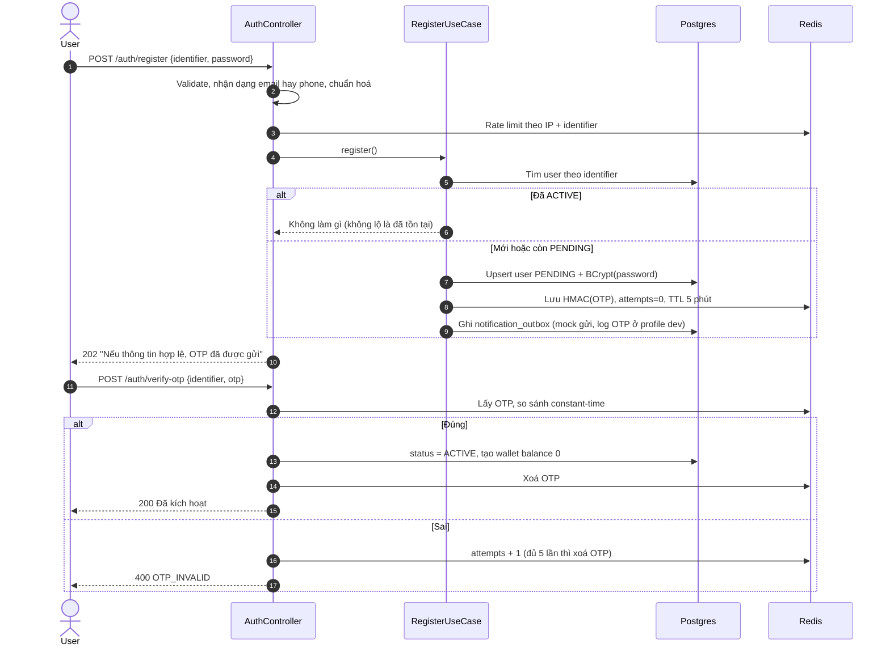

## 6. Luồng đăng nhập, gọi API, đăng xuất

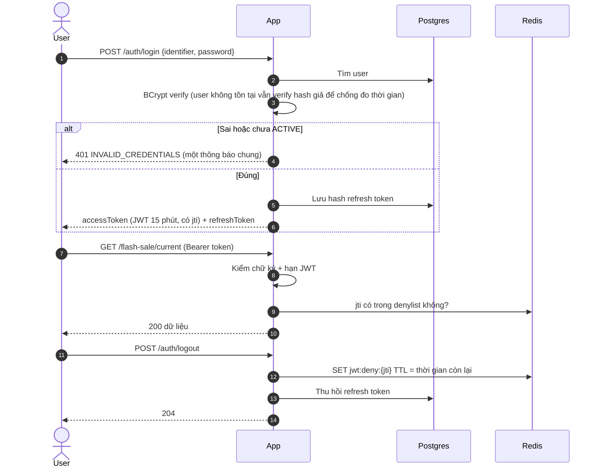

---

## 7. Luồng mua flash sale (trọng tâm)

### 7.1 Đường đi khi thành công

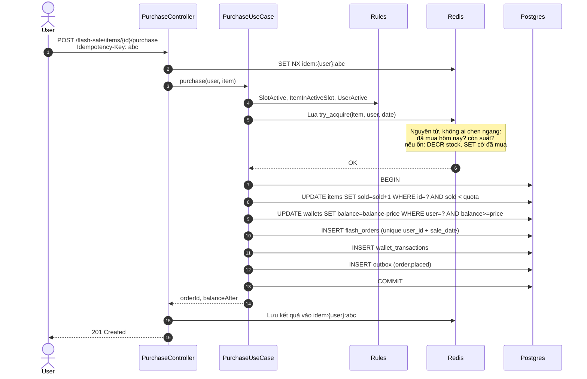

### 7.2 Mọi nhánh rẽ (thất bại và bù trừ)

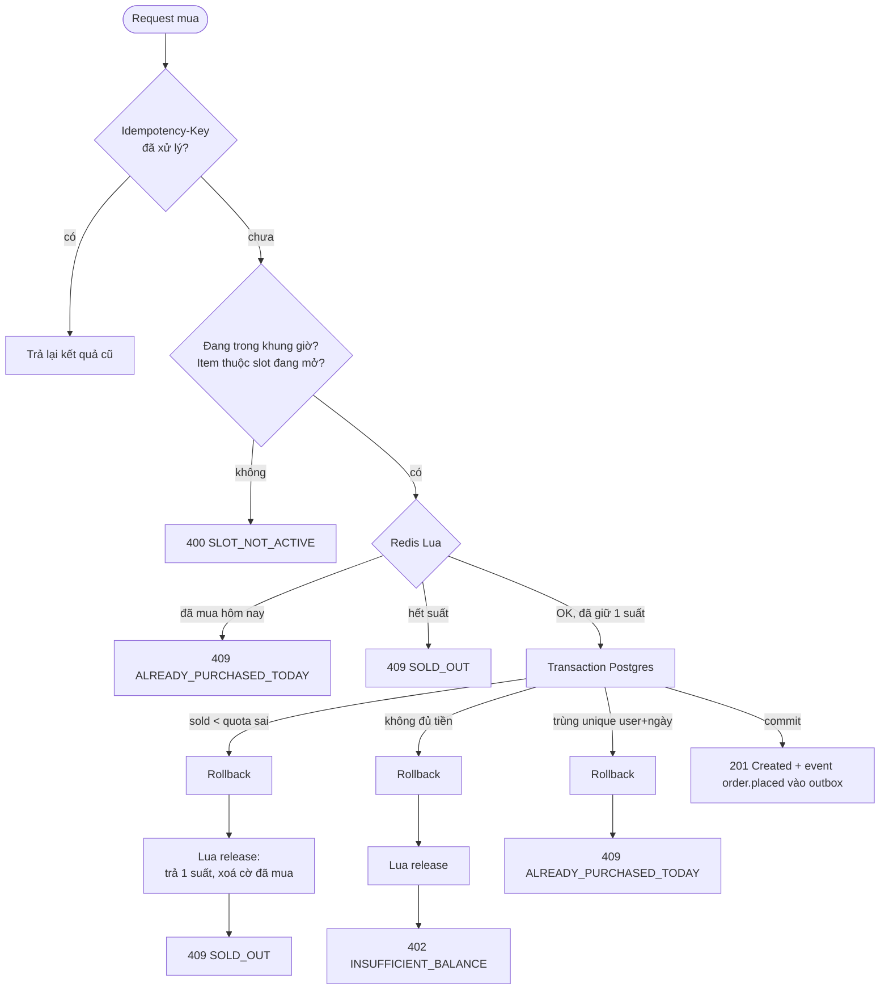

### 7.3 Vì sao không bao giờ bán quá

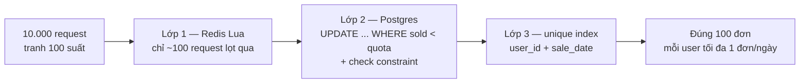

- Lớp 1 để **nhanh**: 9.900 request bị từ chối trong RAM, Postgres không phải gánh.
- Lớp 2, 3 để **đúng**: kể cả Redis lệch số (app chết giữa chừng, Redis restart), Postgres vẫn từ chối phần vượt.
- Không dùng `synchronized` hay lock trong JVM — vô dụng khi chạy nhiều instance. Không dùng distributed lock — chậm và không cần, vì thao tác nguyên tử đã đủ.

### 7.4 Sự cố và cách xử lý

| Sự cố | Hệ quả | Xử lý |
|---|---|---|
| App chết sau khi Redis đã giữ suất, trước khi commit DB | Redis thiếu 1 suất (bán thiếu, **không** bán thừa) | `StockReconciler` định kỳ đặt lại `fs:stock = quota - sold` |
| Redis chết | Không có cổng chặn | Chuyển sang chỉ dùng Postgres (chậm hơn nhưng vẫn đúng) |
| Client bấm mua 2 lần / mạng retry | Có thể tạo 2 request | `Idempotency-Key` trả lại kết quả lần đầu |
| Qua nửa đêm giữa khung giờ | Lệch `sale_date` | Admin không được tạo slot vắt qua 00:00 |

---

## 8. Đồng bộ tồn kho (outbox → RabbitMQ → consumer)

### 8.1 Đường đi của một sự kiện

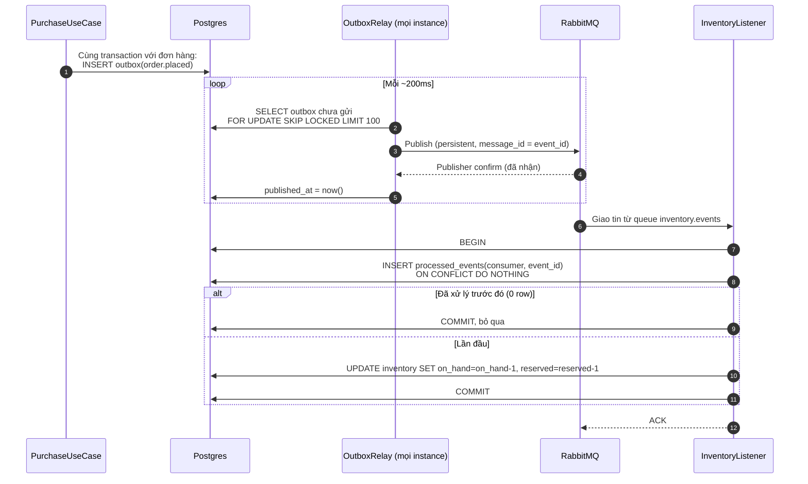

### 8.2 Topology RabbitMQ

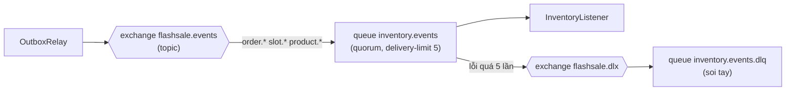

### 8.3 Sự kiện và tác động

| Sự kiện | Khi nào | Tồn kho thay đổi |
|---|---|---|
| `order.placed` | Mua thành công | `on_hand - 1`, `reserved - 1` |
| `slot.closed` | Hết khung giờ / admin đóng | `reserved - (quota - sold)` (trả suất chưa bán về kho) |
| `product.deactivated` | Admin ngừng bán | Gỡ khỏi slot chưa bắt đầu, trả `reserved` |
| `inventory.adjusted` | Admin nhập/xuất kho | Ghi nhận (kiểm `on_hand >= reserved` làm ngay lúc admin sửa) |

**Vì sao "không trùng, nhất quán"**: outbox ghi cùng transaction ⇒ không mất sự kiện. Relay có thể gửi lại (ít nhất 1 lần) ⇒ consumer chống trùng bằng `processed_events` ⇒ kết quả **đúng 1 lần**.

---

## 9. Vòng đời

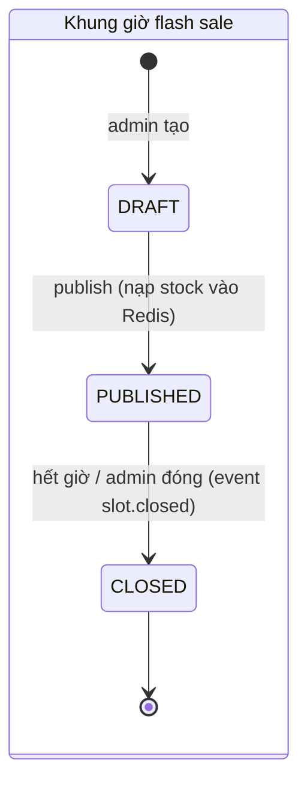

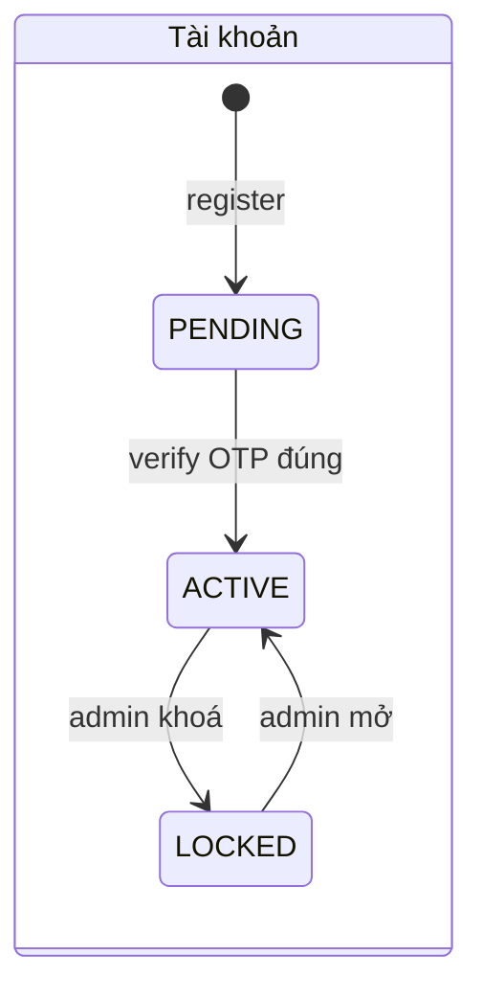

---

## 10. Triển khai local (Docker Compose)

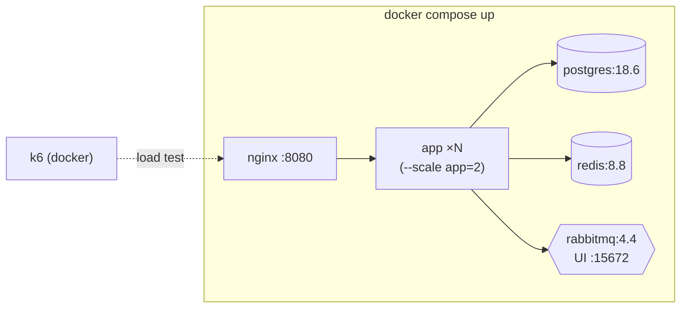

Flyway tự tạo bảng + seed dữ liệu dev (admin, user test có tiền, sản phẩm, khung giờ trong ngày) khi app khởi động.
