# FlashSale Service — System Design

Tài liệu mô tả kiến trúc, dữ liệu và **đường đi của từng luồng** trong hệ thống. Sơ đồ viết bằng Mermaid (GitHub tự hiển thị).

Stack: Java 27 · Spring Boot 4.1 · PostgreSQL 18 · Redis 8 · RabbitMQ 4.4 · nginx · Docker Compose. ClickHouse là hướng mở rộng (không thuộc phạm vi bản nộp).

---

## 1. Tổng quan kiến trúc

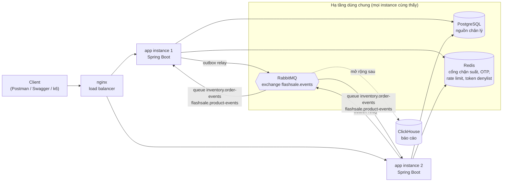

**Ý chính**
- App **không giữ state cục bộ**: mọi thứ cần chia sẻ (OTP, cờ đã mua, số suất, rate limit, token đã logout) nằm ở Redis/Postgres ⇒ thêm instance chỉ là `--scale app=N`.
- **Postgres** quyết định đúng/sai (ràng buộc cứng). **Redis** lọc tải trước khi chạm Postgres. **RabbitMQ** chuyển sự kiện để cập nhật tồn kho bất đồng bộ.
- Mỗi app instance vừa phục vụ API, vừa chạy relay outbox, vừa là consumer — không cần service riêng.

---

## 2. Module bên trong app

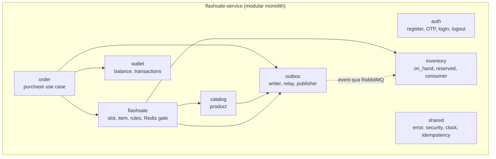

Mỗi module chia 4 lớp, phụ thuộc một chiều (ArchUnit kiểm):

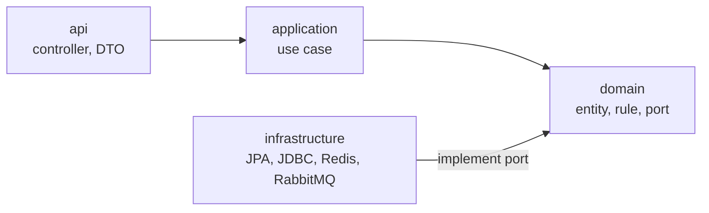

---

## 3. Dữ liệu (PostgreSQL)

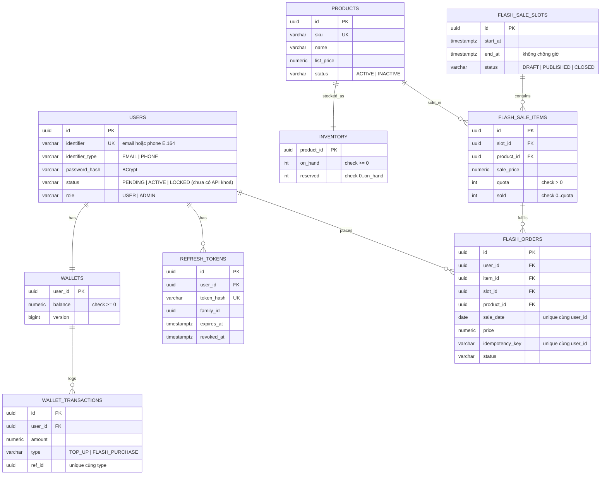

Bảng hạ tầng: `outbox` (sự kiện chờ gửi; gửi lỗi thì lùi lịch theo `next_attempt_at`, tối đa 5 phút/lần), `processed_events` (sự kiện đã xử lý, chống trùng), `notification_outbox` (mock gửi OTP), `refresh_tokens` (hash refresh token).

**Ràng buộc cứng — tuyến phòng thủ cuối cùng**

| Ràng buộc | Chặn lỗi gì |
|---|---|
| `flash_sale_items.sold <= quota` (check) + `UPDATE ... WHERE sold < quota` | Bán quá số lượng |
| `unique (flash_orders.user_id, sale_date)` | User mua 2 sản phẩm flash sale trong 1 ngày |
| `wallets.balance >= 0` + `UPDATE ... WHERE balance >= price` | Trừ tiền âm |
| Exclusion constraint trên `tstzrange(start_at, end_at)` | Hai khung giờ chồng nhau |
| `inventory.reserved <= on_hand` | Cấp quota vượt tồn kho thật |
| `processed_events (consumer, event_id)` PK | Xử lý trùng sự kiện tồn kho |

---

## 4. Redis — key nào, để làm gì

| Key | Giá trị | TTL | Dùng cho |
|---|---|---|---|
| `fs:stock:{itemId}` | số suất còn lại cổng cho qua | đến hết slot + 1h | Hết suất thì từ chối ngay, không chạm DB |
| `fs:bought:{yyyy-MM-dd}:{userId}` | itemId đã mua | 60s khi đang mua, kéo đến hết ngày sau khi commit | Hôm nay đã mua thì từ chối ngay |
| `purchase:lock:{userId}:{key}` | 1 | 30s | Request trùng `Idempotency-Key` đang chạy song song |
| `otp:{identifier}` | hash `{code: HMAC, attempts}` | 5 phút | Xác thực OTP |
| `otp:cooldown:{identifier}` | 1 | 60 giây | Chặn gửi lại OTP liên tục |
| `jwt:deny:{jti}` | 1 | thời gian còn lại của token | Token đã logout |
| `rl:{rule}:{ip/identifier/user}` | bộ đếm | theo cửa sổ | Rate limit |

Redis mất dữ liệu cũng không làm sai: số suất và quyền mua được DB quyết định, các key trên chỉ để lọc tải và tự được đối soát lại.

---

## 5. Luồng đăng ký + OTP

```mermaid
sequenceDiagram
    autonumber
    actor U as User
    participant API as AuthController
    participant S as RegisterUseCase
    participant DB as Postgres
    participant R as Redis

    U->>API: POST /auth/register {identifier, password}
    API->>API: Validate, nhận dạng email hay phone, chuẩn hoá
    API->>R: Rate limit theo IP + identifier
    API->>S: register()
    S->>DB: Tìm user theo identifier
    alt Đã ACTIVE, hoặc PENDING mà OTP cũ còn hiệu lực
        S-->>API: Không làm gì (không lộ là đã tồn tại; mật khẩu cũ giữ nguyên)
    else Mới, hoặc PENDING và OTP cũ đã hết hạn
        S->>DB: INSERT user PENDING ON CONFLICT DO NOTHING (chỉ khi user mới)
        S->>R: Lưu HMAC(OTP), attempts=0, TTL 5 phút
        S->>DB: Ghi notification_outbox (mock gửi, log OTP ở profile dev)
    end
    API-->>U: 202 "Nếu thông tin hợp lệ, OTP đã được gửi"

    U->>API: POST /auth/verify-otp {identifier, otp, password}
    API->>R: Lấy OTP, so sánh constant-time
    alt Đúng
        API->>DB: status = ACTIVE + password_hash = BCrypt(password)<br/>(chỉ khi đang PENDING), mở ví số dư 0
        Note over API,DB: Mật khẩu đặt ở bước này: chỉ người đọc được OTP mới đặt được,<br/>nên đăng ký trước bằng identifier của người khác không chiếm được tài khoản
        API->>R: Xoá OTP
        API-->>U: 200 Đã kích hoạt
    else Sai
        API->>R: attempts + 1 (đủ 5 lần thì xoá OTP)
        API-->>U: 400 OTP_INVALID
    end
```

## 6. Luồng đăng nhập, gọi API, đăng xuất

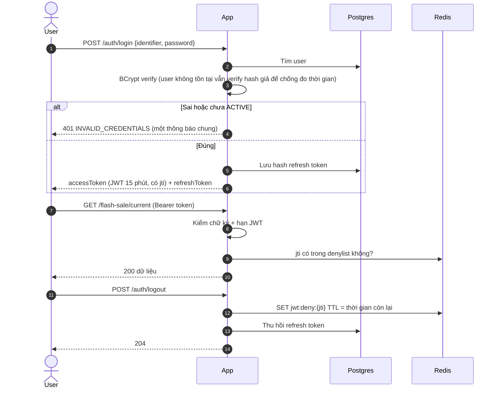

---

## 7. Luồng mua flash sale (trọng tâm)

### 7.1 Đường đi khi thành công

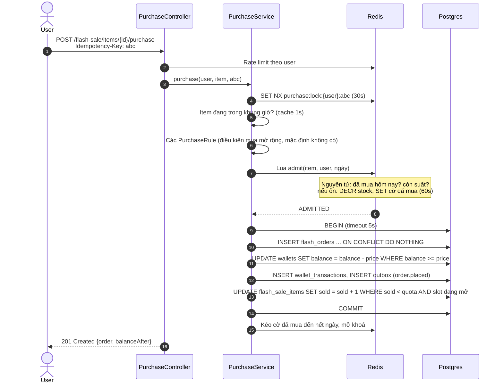

Câu `sold = sold + 1` để cuối cùng: dòng của sản phẩm đang sale là dòng bị tranh chấp nhiều nhất, khoá nó càng muộn thì thời gian giữ khoá càng ngắn.

### 7.2 Mọi nhánh rẽ

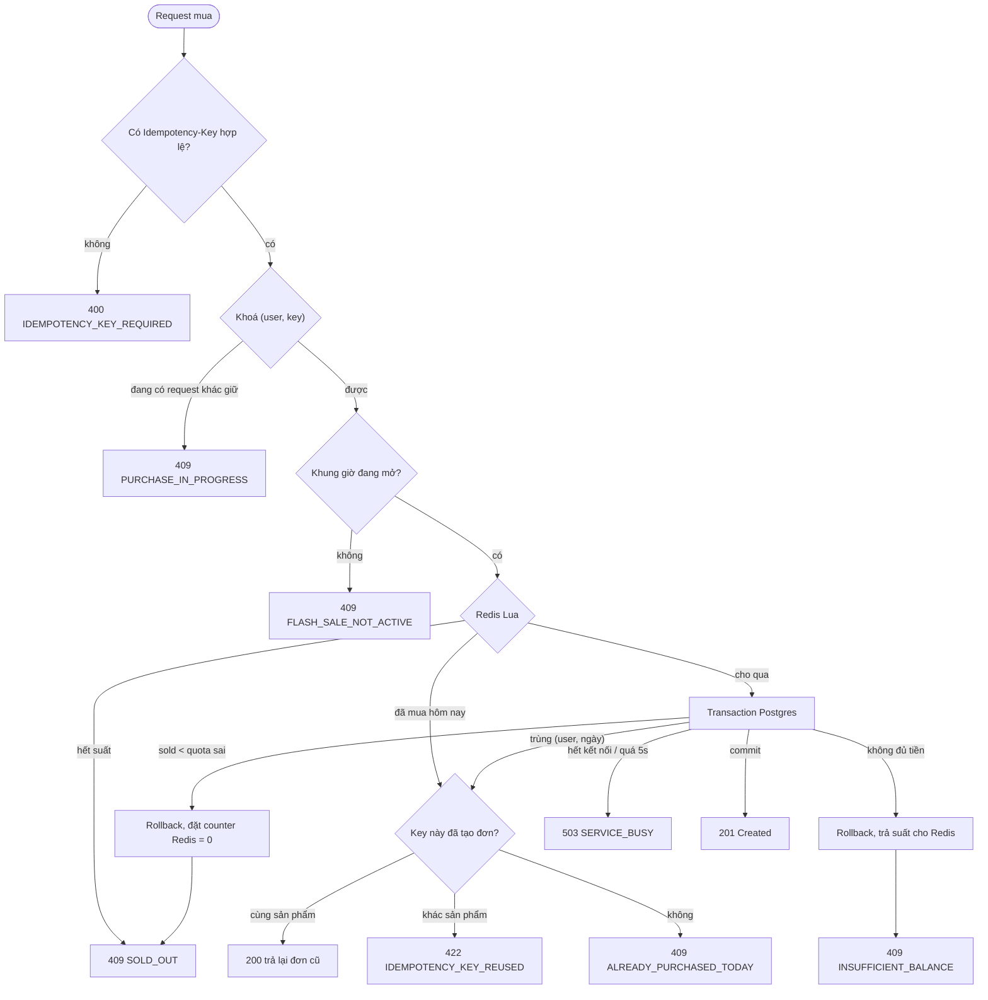

### 7.3 Vì sao không bao giờ bán quá

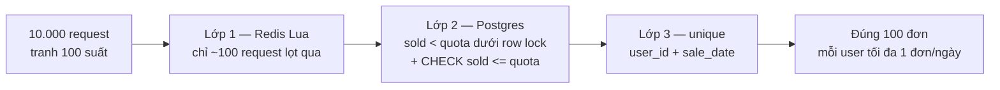

- Lớp 1 để **nhanh**: request hết hy vọng bị từ chối trong RAM, Postgres không phải gánh.
- Lớp 2, 3 để **đúng**: Redis lệch số thế nào (instance chết giữa chừng, Redis restart, Redis chết hẳn), Postgres vẫn từ chối phần vượt. Có test cố tình đặt counter Redis = 100000 để chứng minh.
- Không dùng `synchronized` hay lock trong JVM — vô dụng khi chạy nhiều instance. Không dùng distributed lock — các câu lệnh đã nguyên tử.

### 7.4 Sự cố và cách xử lý

| Sự cố | Hệ quả | Xử lý |
|---|---|---|
| Instance chết sau khi Redis cho qua, trước khi commit | Redis thiếu 1 suất; user có cờ "đã mua" nhưng không có đơn | Cờ chỉ sống 60s nếu chưa commit. `StockReconciler` (60s/lần, mọi instance) ghi đè `fs:stock = quota - sold` |
| Redis chết | Không có cổng chặn, không đọc được token denylist | Lettuce từ chối lệnh ngay khi mất kết nối (không chờ timeout); bỏ qua khoá, cổng, rate limit và denylist (fail open); DB tự quyết, vẫn đúng. Token đã logout còn dùng được tới khi hết hạn (≤ 15 phút). Readiness chỉ kiểm DB nên instance không bị gỡ khỏi load balancer |
| RabbitMQ chết | Sự kiện chưa gửi được | Đơn vẫn tạo; sự kiện chờ trong `outbox`, relay gửi lại khi broker sống lại; tồn kho cập nhật trễ, không mất |
| Redis đếm cao hơn thực tế | Thêm request vào tới DB | DB từ chối, counter Redis được đặt về 0 ngay |
| Bấm mua 2 lần / client retry | 2 request cùng key | Khoá Redis + unique `(user_id, idempotency_key)`; lần sau nhận lại đơn cũ |
| DB quá tải | Hết kết nối trong 3s | 503 + `Retry-After: 1` thay vì 500 |
| Admin đóng slot giữa lúc có người mua | Có thể trả kho sai | Đóng slot = `UPDATE ... SET quota = sold RETURNING old.quota - old.sold` dưới row lock; ai mua sau đó thấy hết hàng |
| Qua nửa đêm | Lệch `sale_date` | Khung giờ không được vắt qua 00:00; ngày được chốt một lần mỗi request |

---

## 8. Đồng bộ tồn kho (outbox → RabbitMQ → consumer)

### 8.1 Đường đi của một sự kiện

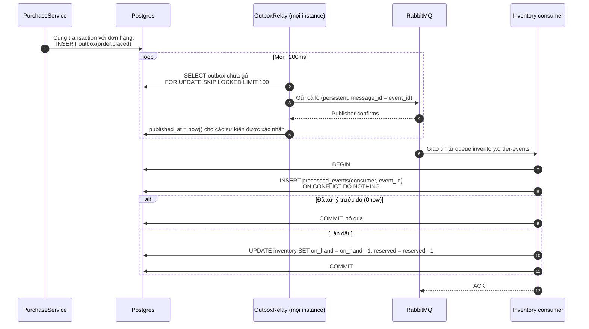

### 8.2 Topology RabbitMQ

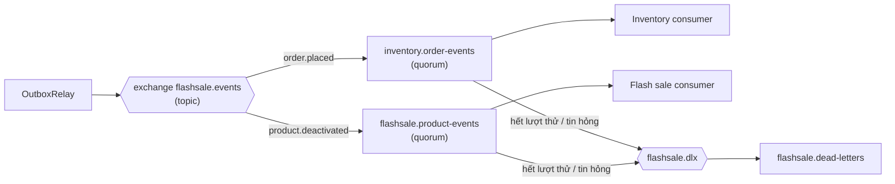

Consumer lỗi được thử lại trong ứng dụng sau 1s, 3s, 9s (đủ để qua một lần DB khởi động lại); vẫn lỗi thì tin bị từ chối và chuyển sang `flashsale.dead-letters` để xem và chuyển lại thủ công. Tin hỏng (thiếu `message_id`, JSON sai) bị từ chối ngay, không thử lại.

Phía gửi: sự kiện bị broker nack hoặc không route được không chặn cả lô; `attempts + 1`, `next_attempt_at = now + min(2^attempts, 300) s`, relay chỉ lấy dòng đã tới hạn. Quá 20 lần thì log ERROR một lần (vẫn giữ dòng để xử lý tay).

### 8.3 Sự kiện và tác động

| Sự kiện | Khi nào | Tồn kho thay đổi |
|---|---|---|
| (đồng bộ) thêm sản phẩm vào khung giờ | Admin | `reserved + quota`, từ chối nếu `on_hand - reserved < quota` |
| (đồng bộ) đóng khung giờ | Admin hoặc job tự đóng khi hết giờ | `reserved - (quota - sold)`, chốt `quota = sold` |
| `order.placed` | Mua thành công | `on_hand - 1`, `reserved - 1` |
| `product.deactivated` | Admin ngừng bán sản phẩm | Gỡ khỏi các khung giờ chưa mở, `reserved - quota` |

Tổng cho mỗi khung giờ: giữ `Q` → bán `S` (trả qua sự kiện) → đóng (trả `Q - S`) → `reserved` về 0, thứ tự nào cũng ra cùng kết quả.

**Vì sao "không trùng, nhất quán"**: outbox ghi cùng transaction ⇒ không mất và không thừa sự kiện. Relay gửi ít nhất 1 lần ⇒ consumer chống trùng bằng `processed_events` trong chính transaction của nó ⇒ tác động xảy ra **đúng 1 lần**.

---

## 9. Vòng đời

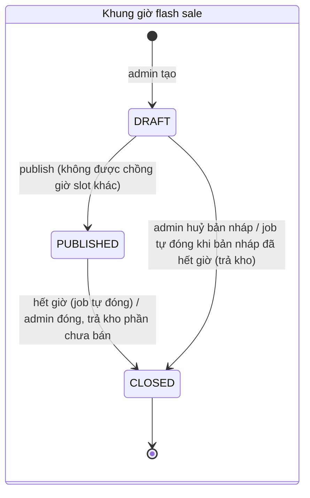

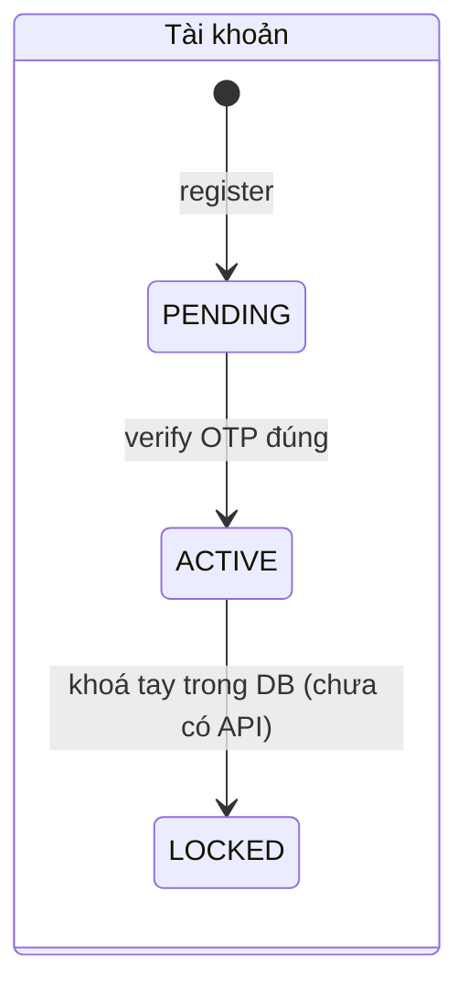

---

## 10. Triển khai local (Docker Compose)


Flyway tự tạo bảng + seed dữ liệu dev (admin, user test có tiền, sản phẩm, khung giờ mỗi 2 tiếng trong 7 ngày) khi app khởi động (chỉ ở profile demo).
